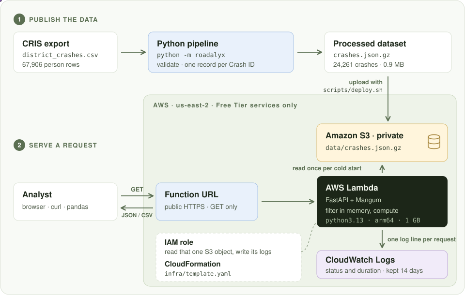
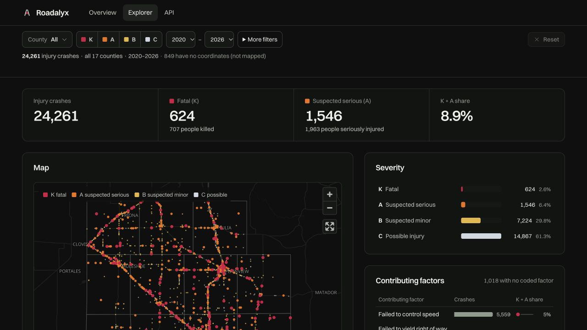

<p align="center">
  
</p>
<h1 align="center">Roadalyx</h1>
<p align="center">Crash analytics for the Lubbock District</p>
<p align="center">
  <a href="https://i2swgeojg6x3hacixkymlgrei40hcxso.lambda-url.us-east-2.on.aws/">Live application</a> ·
  <a href="https://i2swgeojg6x3hacixkymlgrei40hcxso.lambda-url.us-east-2.on.aws/api/docs">API documentation</a> ·
  <a href="notebooks/eda.ipynb">EDA notebook</a>
</p>

I built Roadalyx for the TransTech Lab coding assessment. It turns the supplied TxDOT CRIS export into crash statistics, a Python API and an analyst portal, deployed together on AWS.

## Where to look

| Required work | Files |
|---|---|
| EDA, relevant columns and cleaning decisions | [EDA notebook](notebooks/eda.ipynb) |
| Read, check and clean the CSV | [cris.py](roadalyx/cris.py), [processing command](roadalyx/__main__.py) |
| Severity counts, top five factors and time patterns | [metrics.py](roadalyx/metrics.py) |
| API, shared filters and response formats | [api.py](roadalyx/api.py), [query.py](roadalyx/query.py), [schemas.py](roadalyx/schemas.py) |
| AWS resources and deployment | [template.yaml](infra/template.yaml), [deploy.sh](scripts/deploy.sh) |
| Cleaning and API tests | [test_pipeline.py](tests/test_pipeline.py), [test_api.py](tests/test_api.py) |

## Run locally

I use Python 3.13, matching Lambda. Put the supplied CSV at `data/raw/district_crashes.csv` and run these commands from the repository root:

```bash
python3.13 -m venv .venv
source .venv/bin/activate
pip install -r requirements.txt

python -m roadalyx data/raw/district_crashes.csv
uvicorn roadalyx.api:app --reload
```

The processing command prints the three required results and writes `data/processed/crashes.json.gz`. The API is then available at `http://127.0.0.1:8000/api/docs`.

The raw CSV and processed data are not committed. No environment variables are needed for the commands above.

| Variable | Use |
|---|---|
| `ROADALYX_DATA` | Override the local processed file path; on AWS, CloudFormation supplies the S3 URI |
| `ROADALYX_WEB` | Override `roadalyx/web`, the built frontend directory |
| `AWS_REGION` | Choose the deployment region; the script defaults to `us-east-2` |

### Tests and EDA

```bash
python -m pytest
python -m nbconvert --to notebook --execute --inplace \
  notebooks/eda.ipynb
```

The notebook includes saved tables and charts, so it can also be read on GitHub without running it.

## What I found and changed

The CSV has **67,906 person rows but 24,261 crashes**. I checked that the crash fields agree across rows with the same Crash ID, then built one record per accident. I leave the source person rows unchanged.

My other cleaning choices:

- I locate the header after the 11 introductory lines.
- I split factor lists on `;`, normalize spaces and case, and count each distinct factor once per crash.
- I keep `NONE` and `OTHER (EXPLAIN IN NARRATIVE)` in records, but leave them out of the ranking of specific factors.
- I keep the 849 crashes without coordinates in the statistics, but not on the map.
- I treat 191 speed limits coded `-1` as unknown, read times as HHMM, and normalize the different yes/no spellings.
- I treat `UNKNOWN` and `NA` as missing street names for 26 crashes.
- I reject empty exports and invalid IDs, dates or victim counts. By default, I also stop on inconsistent export totals or conflicting crash fields.

I write the processed file to a temporary file first. It replaces the previous file only after the write succeeds.

The export covers **1 January 2020 to 20 October 2026**:

| Severity | Crashes |
|---|---:|
| K: fatal injury | 624 |
| A: suspected serious injury | 1,546 |
| B: suspected minor injury | 7,224 |
| C: possible injury | 14,867 |

The most frequently recorded factor is *Failed to control speed*, cited in **5,559 crashes**. The [EDA](notebooks/eda.ipynb) shows the full top five and the yearly counts. I mark 2026 as partial in both the API and charts.

## Query the API

The three required results have their own endpoints:

| Endpoint | Result |
|---|---|
| `GET /api/v1/severity` | Crash counts and shares for K, A, B and C, plus victim totals |
| `GET /api/v1/factors?limit=5` | The five most frequently recorded contributing factors |
| `GET /api/v1/trends?by=year` | Crash counts over time, split by severity |

For example, to get fatal and serious-injury crashes in Lubbock County during 2024–2025:

```bash
curl --get 'http://127.0.0.1:8000/api/v1/severity' \
  --data-urlencode 'county=lubbock' \
  --data-urlencode 'severity=K,A' \
  --data-urlencode 'year_from=2024' \
  --data-urlencode 'year_to=2025'
```

The metric and search endpoints share `county`, `severity`, `year_from`, `year_to`, `road_class`, `factor` and `vru` filters. Their JSON responses include the applied filters and matching crash count. An unknown county returns `422` with valid choices; a valid selection with no crashes returns zero.

The processing command and API use the same metric functions. The [API documentation](https://i2swgeojg6x3hacixkymlgrei40hcxso.lambda-url.us-east-2.on.aws/api/docs) also covers crash records, map points, breakdowns and the day/hour grid.

To download every matching crash as CSV:

```bash
curl --get --compressed --output selection.csv \
  'http://127.0.0.1:8000/api/v1/crashes' \
  --data-urlencode 'format=csv' \
  --data-urlencode 'county=lubbock'
```

## AWS deployment

I deploy the API and frontend together in **one Lambda function**, with the processed dataset in **one private S3 bucket**, in `us-east-2`. The public [application URL](https://i2swgeojg6x3hacixkymlgrei40hcxso.lambda-url.us-east-2.on.aws/) serves both the portal and the API.

### Why this architecture

The dataset has 24,261 crashes and fits in memory. I use Python to clean it before deployment, rather than repeating that work for every request. Lambda then loads the cleaned data and answers queries without a database or an always-on server. This keeps the deployment small enough for the assessment.



[View the architecture at full size](docs/assets/architecture.svg)

| Service | What it does and why I chose it |
|---|---|
| **Lambda** | Runs FastAPI and serves the built React files. It starts on demand; I do not maintain a server. I use Python 3.13 on arm64, with 1,024 MB of memory and a 10-second timeout. |
| **Function URL** | Gives Lambda a public HTTPS address. For this read-only app, I do not need API Gateway or a separate frontend host. |
| **S3** | Stores `data/crashes.json.gz` and the deployment ZIPs privately. Keeping data separate lets me replace the dataset without rebuilding the frontend. |
| **IAM** | Gives the function permission to read only its dataset object and write its own logs. Deployment uses my authenticated AWS CLI session, not credentials in the repository. |
| **CloudWatch Logs** | Records request paths, status codes and durations so I can investigate errors. Logs expire after 14 days. |
| **CloudFormation** | Defines the function, runtime permissions, public URL and log group in [template.yaml](infra/template.yaml). The deployment script creates and secures the S3 bucket separately. |

### From CSV to a deployed application

I first complete [Run locally](#run-locally), including processing the supplied CSV. The deployment script **uploads the processed file; it does not clean the CSV itself**.

Deployment also needs Node 22.12+, npm, AWS CLI, `zip`, `rsync` and `curl`. After authenticating the AWS CLI to the intended account, I run this from the repository root:

```bash
aws sts get-caller-identity
scripts/deploy.sh
```

The first command lets me check the deployment account. The script defaults to `us-east-2`; I can set `AWS_REGION` to use another region.

[deploy.sh](scripts/deploy.sh) performs these steps:

1. **Check and build.** Run the Python tests, install the frontend dependencies and build the React files into `roadalyx/web`.
2. **Package the app.** Bundle the API, frontend and Python 3.13 Linux arm64 dependencies into a Lambda ZIP. CSV cleaning stays local, so pandas is not included in Lambda.
3. **Prepare storage.** Create the account-specific S3 bucket if needed. Block public access, enable encryption and require HTTPS. Upload the code ZIP and `data/processed/crashes.json.gz`.
4. **Apply the infrastructure.** Create or update the CloudFormation stack. Set `ROADALYX_DATA` to the private S3 object and attach the runtime IAM role.
5. **Check the endpoint.** Request `/api/health` and print the public URL. This checks that the app responds and can load the dataset; it is not a substitute for checking metric results and the portal.

### What happens when an analyst opens Explorer

1. The browser requests the public Function URL. Lambda serves the frontend files from its package.
2. Explorer calls the API at that same address. Mangum translates the Lambda HTTP event for FastAPI.
3. On the first request that needs crash data, that Lambda instance reads `crashes.json.gz` from private S3 and decompresses it into memory. Later requests in the same instance reuse it. A new instance loads its own copy.
4. FastAPI validates the filters, selects the matching crashes and returns JSON for the charts or CSV for a download. Each request also writes its status and duration to CloudWatch.

The browser does not read S3 directly. The API is public and read-only; the bucket is private.

### Updating only the dataset

After receiving a replacement export, I process it locally and then run:

```bash
python -m roadalyx data/raw/district_crashes.csv
scripts/deploy.sh data
```

This runs the Python tests, uploads the processed dataset and updates its version in the function configuration. New Lambda instances load the replacement data. It does not rebuild or upload the frontend.

### Cost boundaries

I chose services with Free Tier allowances and avoided a database, API Gateway and an always-on server. In-memory reuse reduces S3 reads, and the script keeps only the current and previous code packages. Logs have a 14-day retention limit.

These choices limit usage, but **do not guarantee a zero bill**. Requests, execution time, storage and logs must remain within the account's available allowances or credits. The public URL has no application-level rate limiting. I would check account eligibility and billing before leaving it publicly available for longer or sharing it more widely.

## Limits and next steps

- The export contains injury crashes only (K/A/B/C), not property-damage-only crashes.
- Without traffic volumes or vehicle miles traveled, I can compare counts and severity shares, not crash rates.
- The data ends on 20 October 2026. Recent counts may change as more reports are added.
- The pipeline expects the supplied CRIS layout.
- The public URL has no application-level rate limiting, so heavy traffic can consume the account's allowances or credits.

Given more time, I would add request throttling and a validated data-refresh workflow.

## Frontend

For the optional frontend, I built a React portal in [web](web/) on top of the required API. I added:

- **A linked Explorer view.** County, severity, year, road class, contributing factor and pedestrian/cyclist filters update the map and charts together. The URL keeps the selection for sharing.
- **More ways to compare crashes.** Severity and factor charts, four time axes, a day/hour heatmap, and breakdowns by county, road class, rural/urban setting, intersection, collision type, first harmful event, weather or speed limit. The factor chart shows ten factors; the required top five remain available through the API.
- **A way to inspect the underlying records.** A full-screen map, sortable and paginated records, individual crash details and a CSV download of the filtered selection. Unmapped crashes stay in the statistics and records.
- **Supporting API queries.** Metadata, map points, breakdowns, the day/hour grid and crash records let the frontend use the same cleaned data and filters as the three required metric endpoints.

[](https://i2swgeojg6x3hacixkymlgrei40hcxso.lambda-url.us-east-2.on.aws/explorer)

Overview provides a 3D view of the located crashes over time. Its visual effects are not measures of road risk.

To run the frontend locally, use Node 22.12+ and keep the API running on port 8000:

```bash
npm --prefix web ci
npm --prefix web run dev
npm --prefix web test
```

Vite prints the local URL. `npm --prefix web run build` writes the frontend to `roadalyx/web`, which FastAPI serves at `/`.

---

Data: TxDOT CRIS export supplied by TransTech Lab. County boundaries: US Census Bureau via `us-atlas`. Basemap: OpenFreeMap, OpenMapTiles and OpenStreetMap contributors.
