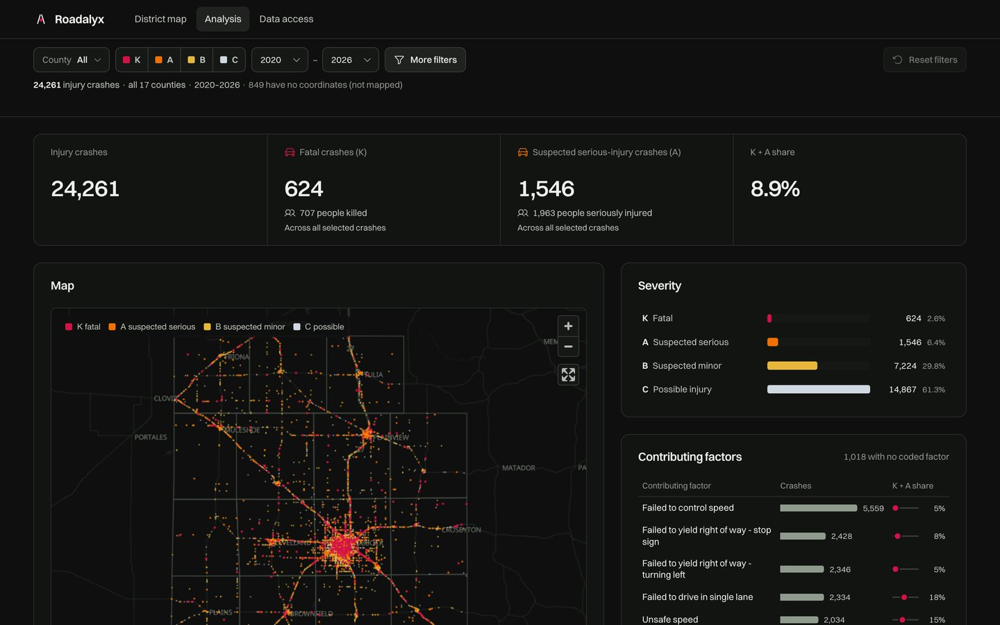
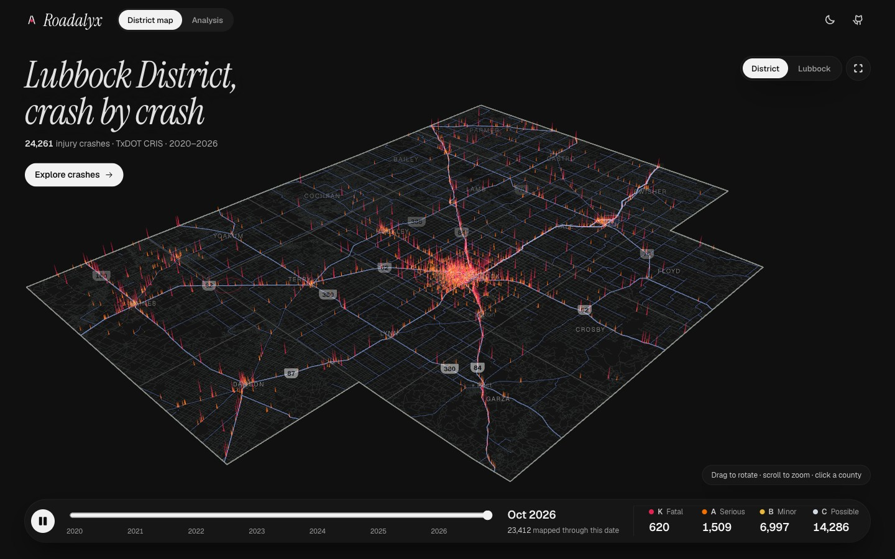

<p align="center">
  
</p>
<h1 align="center">Roadalyx</h1>
<p align="center">
  TxDOT CRIS crash data for the Lubbock District, cleaned in Python,<br>
  served by a REST API on AWS Lambda, explored on a map.
</p>
<p align="center">
  <a href="https://i2swgeojg6x3hacixkymlgrei40hcxso.lambda-url.us-east-2.on.aws/"><b>Live application</b></a> ·
  <a href="https://i2swgeojg6x3hacixkymlgrei40hcxso.lambda-url.us-east-2.on.aws/api/docs">API reference</a> ·
  <a href="notebooks/eda.ipynb">EDA notebook</a>
</p>
<p align="center">
  <a href="pyproject.toml"></a>
  <a href="https://i2swgeojg6x3hacixkymlgrei40hcxso.lambda-url.us-east-2.on.aws/api/docs"></a>
  <a href="#deployment-on-aws"></a>
  <a href="web/"></a>
  <a href="tests/"></a>
</p>
<p align="center">
  <a href="https://i2swgeojg6x3hacixkymlgrei40hcxso.lambda-url.us-east-2.on.aws/analysis">
    
  </a>
</p>

I built Roadalyx for the TransTech Lab Graduate Assistant coding assessment. The supplied CRIS export lists **67,906 people involved in 24,261 injury crashes** in the 17 counties of the TxDOT Lubbock District, from 1 January 2020 to 20 October 2026. A Python pipeline turns it into one clean record per crash, a FastAPI service answers questions about it, and both run on AWS within the Free Tier.

## Contents

1. [The assessment, part by part](#the-assessment-part-by-part)
2. [Run it locally](#run-it-locally)
3. [The data: what I found and the three results](#the-data-what-i-found-and-the-three-results)
4. [The API](#the-api)
5. [Deployment on AWS](#deployment-on-aws)
6. [Scope decisions](#scope-decisions)
7. [Limitations and what I would do next](#limitations-and-what-i-would-do-next)
8. [The frontend](#the-frontend)

## The assessment, part by part

| Requirement | Where it is |
|---|---|
| **EDA and cleaning**: relevant columns, quality issues, decisions and reasons | [`notebooks/eda.ipynb`](notebooks/eda.ipynb), executed, so it reads on GitHub without the data |
| **Data processing**: severity counts, top 5 factors, time patterns | `python -m roadalyx` · [`cris.py`](roadalyx/cris.py) (cleaning), [`metrics.py`](roadalyx/metrics.py) (the three results) |
| **REST API**: at least 3 endpoints, 1 filter, JSON or CSV | 10 endpoints, 7 filters, JSON and CSV · [`api.py`](roadalyx/api.py), [`query.py`](roadalyx/query.py), [`schemas.py`](roadalyx/schemas.py) |
| **Deployment**: AWS Free Tier, public URL, no credentials in code | [Live URL](https://i2swgeojg6x3hacixkymlgrei40hcxso.lambda-url.us-east-2.on.aws/) · [`infra/template.yaml`](infra/template.yaml), [`scripts/deploy.sh`](scripts/deploy.sh) |
| **README and dependencies** | This file · [`requirements.txt`](requirements.txt) (local), [`requirements-lambda.txt`](requirements-lambda.txt) (Lambda) |
| **Tests** | [`tests/`](tests/): cleaning rules, API filters and errors, totals that must match across endpoints |
| **Frontend** for a traffic safety analyst | [`web/`](web/) · [Analysis page](https://i2swgeojg6x3hacixkymlgrei40hcxso.lambda-url.us-east-2.on.aws/analysis) |

## Run it locally

You need **Python 3.12 or 3.13** and the CSV supplied with the assessment. Node 22.12+ is needed only for the frontend. Setup takes about a minute.

```bash
git clone https://github.com/HEPHAISTOS89/roadalyx.git
cd roadalyx
python3 --version
```

Check that the version is **3.12.x or 3.13.x** before creating the environment. If `python3` points to another version, use `python3.13` or `python3.12` in the command below instead. If neither is installed, install one first.

```bash
python3 -m venv .venv
source .venv/bin/activate
python --version                  # should still show 3.12.x or 3.13.x
python -m pip install -r requirements.txt
```

On Windows, create the environment with `py -3.13 -m venv .venv` (or `py -3.12 -m venv .venv`). Activate it with `.\.venv\Scripts\Activate.ps1` in PowerShell, or `.venv\Scripts\activate.bat` in Command Prompt. Then run the same `python --version` and `python -m pip install -r requirements.txt` commands.

**1. Clean the data.** Copy the supplied file into `data/raw/`, then run the pipeline. It prints the three required results and writes `data/processed/crashes.json.gz`.

```bash
cp /path/to/district_crashes.csv data/raw/
python -m roadalyx data/raw/district_crashes.csv
```

```
24,261 crashes from 67,906 person rows, 2020-01-01 to 2026-10-20

Crashes by severity (KABCO)
  K  Fatal injury                   624    2.6%
  ...
Wrote 24,261 crash records to data/processed/crashes.json.gz (0.9 MB)
```

**2. Run the tests.**

```bash
python -m pytest                   # 93 tests, a few seconds
```

**3. Start the API**, then open <http://127.0.0.1:8000/api/docs> to try every endpoint in the browser. Stop it with Ctrl+C.

```bash
uvicorn roadalyx.api:app --reload
```

The raw CSV and the processed file are not committed: the CSV is the lab's file and holds person-level records. If the file disagrees with its own header (crash or person counts) or a crash's rows conflict, the pipeline stops and writes nothing.

**Environment variables.** None are needed to run locally.

| Variable | Default | Purpose |
|---|---|---|
| `ROADALYX_DATA` | `data/processed/crashes.json.gz` | Processed dataset: a local path, or `s3://bucket/key` on AWS |
| `ROADALYX_WEB` | `roadalyx/web` | Built frontend that the API serves at `/` |
| `AWS_REGION` | `us-east-2` | Region used by `scripts/deploy.sh` |

<details>
<summary><b>Also:</b> the frontend and the EDA notebook</summary>

**Keep the API running in the first terminal. Open a second terminal at the repository root** (`roadalyx/`) for the commands below. Build the frontend once, then open <http://127.0.0.1:8000/>. There is no need to restart the API after the build.

```bash
npm --prefix web ci
npm --prefix web run build         # writes roadalyx/web, served by the API at /
npm --prefix web test              # 13 tests
```

To change the frontend with live reload, keep the API running and start `npm --prefix web run dev` in a second terminal, then open <http://localhost:5173>.

To re-run the notebook from scratch (it is already saved with its outputs), first activate `.venv` in this second terminal, as in the setup above:

```bash
python -m nbconvert --to notebook --execute --inplace notebooks/eda.ipynb
```
</details>

## The data: what I found and the three results

**One row is a person, not a crash.** The export has 67,906 rows for 24,261 crashes: every driver, passenger and pedestrian gets a row, and the crash's fields are copied onto each of them. Counting rows would count a four-person crash four times. I checked that the copied crash fields never disagree inside a crash, then built one record per Crash ID. The result matches the export's own header (24,261 crashes).

The other problems, and what I do about them:

| Problem in the file | What I do | Why |
|---|---|---|
| 11 lines of disclaimer and a byte-order mark before the header | Find the header row by its first cell | Works for any CRIS export, whatever its filter list |
| Factors separated by `;` in some rows, `; ` in others | Split on `;`, trim, count each factor once per crash | Otherwise *Failed to control speed* counts as two factors (5,018 + 541) |
| `NONE` and `OTHER (EXPLAIN IN NARRATIVE)` in the factors | Kept in the data, left out of the ranking | They say no factor was coded |
| 849 crashes without coordinates (`No Data`) | Kept in every count, left off the map | A missing location does not remove a crash |
| Speed limit `-1`; time stored as HHMM (`5` = 00:05) | `-1` becomes missing; times become hour and HH:MM | `-1` is a code, not a speed |
| Yes/No, YES/NO and true/false in flag columns | Converted to true/false | One spelling per answer |
| 2026 ends on 20 October | Marked as a partial year and month | So 2026 does not look like a drop |

The full reasoning, with the code that checks each point, is in the [EDA notebook](notebooks/eda.ipynb).

**The three required results**, printed by `python -m roadalyx`:

<table>
<tr><th>1 · Crashes by severity (KABCO)</th><th>2 · Top 5 contributing factors</th><th>3 · Crashes per year</th></tr>
<tr valign="top"><td>

| | Crashes | Share |
|---|---:|---:|
| **K** Fatal | 624 | 2.6% |
| **A** Serious | 1,546 | 6.4% |
| **B** Minor | 7,224 | 29.8% |
| **C** Possible | 14,867 | 61.3% |

</td><td>

| Factor | Crashes |
|---|---:|
| Failed to control speed | 5,559 |
| Failed to yield, stop sign | 2,428 |
| Failed to yield, turning left | 2,346 |
| Failed to drive in single lane | 2,334 |
| Unsafe speed | 2,034 |

</td><td>

| Year | Crashes |
|---|---:|
| 2020 | 3,351 |
| 2021 | 3,971 |
| 2022 | 3,716 |
| 2023 | 3,673 |
| 2024 | 3,452 |
| 2025 | 3,444 |
| 2026 | 2,654 ¹ |

</td></tr>
</table>

¹ Partial year: the export ends on 20 October 2026.

The 624 fatal crashes killed 707 people. A crash can cite several factors, so factor shares do not add up to 100%. The API also gives the time pattern by month, hour of day and day of the week.

## The API

FastAPI, read-only (`GET`), with the interactive reference at [`/api/docs`](https://i2swgeojg6x3hacixkymlgrei40hcxso.lambda-url.us-east-2.on.aws/api/docs). I designed the endpoints around the questions an analyst or a dashboard asks:

| Question | Endpoint |
|---|---|
| How many crashes, how severe? | `/api/v1/severity` |
| Which factors come up most? | `/api/v1/factors?limit=5` |
| Is it rising or falling, at what time of day? | `/api/v1/trends?by=year\|month\|hour\|weekday` |
| Which day and hour are worst? | `/api/v1/heatmap` |
| Which county, road class, weather…? | `/api/v1/breakdown?by=county\|road_class\|rural\|weather\|collision\|first_event\|intersection\|speed_limit` |
| Give me the records, or a CSV for Excel or pandas | `/api/v1/crashes?limit=&offset=&sort=` · `/api/v1/crashes?format=csv` |
| One crash | `/api/v1/crashes/{crash_id}` |
| Points for a map | `/api/v1/points` |
| What can I filter on? Is the service up? | `/api/v1/meta` · `/api/health` |

**The same 7 filters work on every data endpoint**, combined with AND: `county`, `severity`, `year_from`, `year_to`, `road_class`, `factor`, `vru` (pedestrian, pedalcyclist, motorcyclist). Values are case-insensitive, and a list can be comma-separated.

```bash
curl 'https://i2swgeojg6x3hacixkymlgrei40hcxso.lambda-url.us-east-2.on.aws/api/v1/severity?county=hale&severity=K,A'
```

```json
{
  "filters": {"county": ["hale"], "severity": ["K", "A"], "year_from": null, "year_to": null, "...": "..."},
  "severity": [{"code": "K", "label": "Fatal injury", "crashes": 31, "share": 0.2214}, "..."],
  "ka_share": 1.0, "deaths": 34, "serious_injuries": 133, "total": 140
}
```

Every answer repeats the filters it applied and the number of matching crashes, so a number never travels without its selection. An unknown value returns **422 with the list of valid values**, instead of an empty answer that would look like zero crashes. The CSV export is gzip-compressed (browsers, pandas and `requests` decode it automatically; add `--compressed` with curl):

```python
import pandas as pd
url = "https://i2swgeojg6x3hacixkymlgrei40hcxso.lambda-url.us-east-2.on.aws/api/v1/crashes"
fatal_and_serious = pd.read_csv(f"{url}?format=csv&county=lubbock&severity=K,A")
```

## Deployment on AWS

<p align="center">
  
</p>

### Why this architecture

The cleaned dataset is small: 24,261 records, 0.9 MB compressed. Held in memory, any filter answers in milliseconds, so **the whole application is one Lambda function** that loads the file once and computes every answer from memory. There is no database to run and no server to keep on, and an idle function costs nothing. The cleaning (pandas) runs once per export, on a laptop, rather than on every request.

### The services, and why each one

| Service | What it does here | Why this one |
|---|---|---|
| **AWS Lambda** | Runs the FastAPI app (through the Mangum adapter) and serves the built frontend. Python 3.13, arm64, 1 GB, 10 s timeout. | Pay-per-request with a permanent free allowance. arm64 is cheaper per second than x86. |
| **Lambda Function URL** | The public HTTPS address of the function. | A public, read-only API needs no keys, usage plans or request mapping, so API Gateway would add a service without adding a feature. |
| **Amazon S3** | Private bucket holding `data/crashes.json.gz` and the last two code packages. | Keeps data separate from code: a new export is published without rebuilding the app. |
| **IAM** | The function's role: read that one S3 object, write its own logs. | Least privilege. Lambda receives short-lived credentials for the role; no access key exists in the code or the repository. |
| **CloudWatch Logs** | One JSON line per request (path, status, duration), kept 14 days. | Enough to see what is slow or failing, without paying to store old logs. |
| **CloudFormation** | Declares the function, URL, role, permissions and log group in [`infra/template.yaml`](infra/template.yaml). | The deployment is reviewable code, and a redeploy changes only what changed. |

### How the data flows

**1 · Publish the data** (on a laptop, once per CRIS export)

1. `python -m roadalyx` reads the CSV, checks it against its header, builds one record per crash and writes `crashes.json.gz`.
2. `scripts/deploy.sh` uploads that file to the private bucket and passes its version (ETag) to CloudFormation, so new Lambda instances load the new data.

**2 · Serve a request** (for example `GET /api/v1/severity?county=hale`)

1. The browser, curl or pandas calls the Function URL over HTTPS. The browser loads the frontend from the same address, so there is no second host and no cross-origin setup.
2. Lambda starts an instance if none is warm. **On a cold start only**, it reads `crashes.json.gz` from S3 with its role's credentials (about 1 s, measured) and keeps it in memory; warm requests reuse it.
3. FastAPI validates the parameters, `Filters` keeps the matching crashes, and `metrics` computes the answer, with the same functions as the command line.
4. The response is gzipped and returned with security and cache headers. One log line goes to CloudWatch.

The bucket is never public: only the function reads it, through its role.

### Alternatives I did not use

| Option | Why not here |
|---|---|
| EC2, ECS or App Runner | An always-on server for an API that is idle most of the time: cost and maintenance for nothing. |
| A database (RDS, DynamoDB, Athena) | 0.9 MB fits in memory and filters in milliseconds; a database would add cost and a second thing to secure. |
| API Gateway | Useful for API keys, usage plans and throttling; a read-only public API needs none of them yet. It is the first thing I would add for heavier traffic. |
| S3 website and CloudFront for the frontend | A second origin to deploy and secure; Lambda already serves the built files from the same URL. |
| Cleaning inside Lambda or Glue | The export arrives rarely and the cleaning needs pandas; running it on every cold start would be slower and dearer. |

### Staying within the Free Tier

| Service | Free allowance | This project |
|---|---|---|
| Lambda | 1 million requests and 400,000 GB-seconds per month, permanently | A warm request takes tens of milliseconds at 1 GB, so even a few hundred thousand requests stay far below it |
| Function URL, IAM, CloudFormation | No charge | — |
| CloudWatch Logs | 5 GB of logs per month | A few kilobytes per day, deleted after 14 days |
| S3 | A few gigabytes of storage | About 13 MB: the dataset and two code packages |

There is no NAT gateway, database, load balancer or always-on instance. The account itself is on the AWS Free plan, which cannot generate a bill.

### Security

- No credentials in the code: the deploy script uses the operator's AWS CLI session and fails without one.
- Bucket: Block Public Access, server-side encryption, and a policy that refuses non-HTTPS requests.
- API: `GET` only, every parameter validated, pages capped at 1,000 records.
- Every response carries a strict Content-Security-Policy, HSTS and `nosniff`. Errors are never cached; data answers are cached for 5 minutes.
- CSV cells that start with `=`, `+`, `-` or `@` are escaped, so an export cannot run as a spreadsheet formula.
- The raw CRIS file, which holds person-level records, is never uploaded or committed.

### Deploy it yourself

```bash
aws sts get-caller-identity          # check which account you are about to deploy to
scripts/deploy.sh                    # full deployment
scripts/deploy.sh data               # after processing a new export: upload the data only
```

`scripts/deploy.sh` needs the AWS CLI, Node 22.12+, `zip`, `rsync`, `curl` and the `.venv` from [Run it locally](#run-it-locally). It runs these steps and stops at the first failure:

1. **Test.** Run the Python tests.
2. **Build.** Build the frontend into `roadalyx/web`.
3. **Package.** Install the Lambda dependencies as Linux arm64 wheels and zip them with the API (about 6 MB). The cleaning code and pandas stay out of the package.
4. **Store.** Create the bucket on the first run and apply its security settings, then upload the package and the dataset. Older packages are deleted; the current one and the previous one are kept.
5. **Deploy.** Create or update the CloudFormation stack.
6. **Check.** Call `/api/health` and print the public URL.

## Scope decisions

With a few hours for the task, I put the time where a mistake would change the answer: counting crashes instead of people, splitting the factor lists correctly, and flagging the partial year. The notebook and the tests check each of these against the totals in the export's header.

Everything else stays small: one set of filters shared by every endpoint, one Lambda function reading one file, and one frontend built on the same API. I did not add user accounts, a database or rate limiting; a read-only dataset of 24,261 crashes does not need them yet.

## Limitations and what I would do next

- The export only has injury crashes (K, A, B, C), so the totals are not all crashes.
- Without traffic volumes, I can say where crashes happen and how severe they are, but not which road is the most dangerous. With TxDOT's traffic counts (AADT), I would compute crash rates per road segment.
- The last months may still grow: the data ends on 20 October 2026 and crash reports keep arriving.
- Anyone can call the public URL as often as they like. Before sharing it widely, I would put API Gateway with a usage limit in front of it.
- A new export is processed on my laptop. Next, I would have S3 start the processing when a file is uploaded.

## The frontend

A React frontend in [`web/`](web/), served by the same Lambda function and built only on the public API. It has two pages:

- **[Analysis](https://i2swgeojg6x3hacixkymlgrei40hcxso.lambda-url.us-east-2.on.aws/analysis)**, for working with the data. Filters (county, severity, years, road class, factor, road users) update everything at once and are kept in the URL, so a view can be shared. It shows the key figures, a map of every located crash, severity and factor charts, trends on four time axes, a day-by-hour grid, a breakdown table, the crash records, and a CSV download of the current selection.
- **[District map](https://i2swgeojg6x3hacixkymlgrei40hcxso.lambda-url.us-east-2.on.aws/district-map)**, a 3D view of the 17 counties where the crashes build up month by month from 2020 to 2026. Clicking a county opens its figures and a link to the Analysis page.

<p align="center">
  
</p>

Charts have text equivalents (tooltips and data tables), work with the keyboard, and respect the reduced-motion setting.

## Repository layout

```
roadalyx/            Python package
  cris.py            read the CRIS export, one record per crash (pandas, pipeline only)
  metrics.py         severity, factors, trends, heat map, breakdowns (shared with the API)
  api.py             FastAPI app and Lambda handler; serves the built frontend
  query.py           the shared filters
  dataset.py         the processed file, loaded from disk or S3
  schemas.py         response models (they generate the API reference)
  __main__.py        the command: python -m roadalyx
notebooks/eda.ipynb  exploratory analysis and cleaning decisions
tests/               pytest suite and a small synthetic CRIS file
infra/template.yaml  CloudFormation template
scripts/deploy.sh    test, build and deploy
web/                 React frontend (Vite, MapLibre, three.js)
data/raw/            put district_crashes.csv here (not committed)
```

---

<sub>Data: TxDOT Crash Records Information System (CRIS), query export supplied by TransTech Lab; TxDOT makes no warranty as to the accuracy of CRIS data. County boundaries: US Census Bureau, via `us-atlas`. Basemap: OpenFreeMap, © OpenMapTiles, © OpenStreetMap contributors. Developed with the help of an AI coding assistant (Claude Code).</sub>
