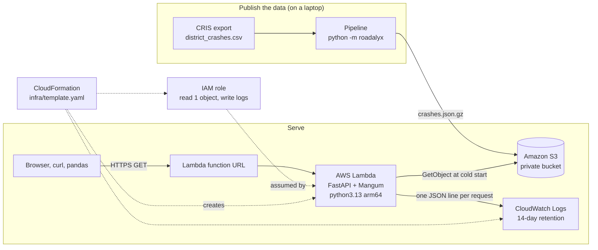

# Roadalyx

Crash analytics for the **TxDOT Lubbock District**, built from the TxDOT CRIS export provided with the
TransTech Lab assessment: 24,261 injury crashes (K, A, B, C) across 17 counties, 1 Jan 2020 to 20 Oct 2026.

- **Portal and API:** https://i2swgeojg6x3hacixkymlgrei40hcxso.lambda-url.us-east-2.on.aws/
- **API reference (OpenAPI):** https://i2swgeojg6x3hacixkymlgrei40hcxso.lambda-url.us-east-2.on.aws/api/docs
- **EDA and cleaning decisions:** [`notebooks/eda.ipynb`](notebooks/eda.ipynb)

```
python -m roadalyx data/raw/district_crashes.csv      # clean, validate, print the three metrics
uvicorn roadalyx.api:app                              # serve the API (and the portal, once built)
scripts/deploy.sh                                     # test, build, deploy to AWS
```

## Contents

1. [What it does](#what-it-does)
2. [Run it locally](#run-it-locally)
3. [The data and how it is cleaned](#the-data-and-how-it-is-cleaned)
4. [API](#api)
5. [Deployment on AWS](#deployment-on-aws)
6. [Bonus: the portal](#bonus-the-portal)
7. [Limitations and next steps](#limitations-and-next-steps)

## What it does

| Part | Where | What |
|---|---|---|
| EDA | `notebooks/eda.ipynb` | Which columns matter and why, the data quality issues found, each cleaning decision and its reason. Executed, so it reads on GitHub without the data. |
| Processing | `roadalyx/cris.py`, `roadalyx/metrics.py` | Reads the CSV, builds one record per crash, computes crash counts by severity, the top contributing factors and time patterns. |
| API | `roadalyx/api.py` | FastAPI, 10 read-only endpoints, 7 shared filters, JSON or CSV. |
| Deployment | `infra/template.yaml`, `scripts/deploy.sh` | One CloudFormation stack: Lambda with a function URL, IAM role, CloudWatch log group; data in a private S3 bucket. |
| Portal (bonus) | `web/` | A 3D landing view of the district, an Explorer with map, charts and tables, and a page that shows the architecture live. |
| Tests | `tests/` | 32 pytest checks on a synthetic CRIS-shaped file, plus one on the real export when it is present. |

```
roadalyx/        Python package: cleaning, metrics, dataset I/O, API
  cris.py        CRIS export -> one record per crash (pandas; pipeline only)
  metrics.py     severity counts, top factors, trends, heat map, breakdowns (pure Python)
  query.py       the shared filters
  dataset.py     the processed file format, loaded locally or from S3
  api.py         FastAPI app + Lambda handler; serves the built portal
  schemas.py     response models (they generate the OpenAPI reference)
notebooks/       EDA notebook
tests/           pytest suite and a small synthetic CRIS fixture
infra/           CloudFormation template
scripts/         deploy script
web/             React portal (Vite, three.js, MapLibre); builds into roadalyx/web
data/raw/        put district_crashes.csv here (not committed)
```

## Run it locally

Requirements: Python 3.12+ (3.13 matches Lambda), Node 20+ only for the portal.

```bash
python3.13 -m venv .venv && source .venv/bin/activate
pip install -r requirements.txt

# 1. Put the provided CSV at data/raw/district_crashes.csv, then process it
python -m roadalyx data/raw/district_crashes.csv
# prints the three metrics and writes data/processed/crashes.json.gz

# 2. Serve the API
uvicorn roadalyx.api:app --reload
# http://127.0.0.1:8000/api/docs

# 3. Tests
pytest
```

The portal, optional:

```bash
npm --prefix web install
npm --prefix web run dev          # http://localhost:5173, proxies /api to port 8000
npm --prefix web run build        # builds into roadalyx/web, then uvicorn serves it at /
```

**Environment variables.** None are required locally.

| Variable | Default | Purpose |
|---|---|---|
| `ROADALYX_DATA` | `data/processed/crashes.json.gz` | Processed dataset: a path, or `s3://bucket/key` on AWS |
| `ROADALYX_WEB` | `roadalyx/web` | Built portal to serve at `/` (skipped if absent) |
| `AWS_REGION` | `us-east-2` | Region for `scripts/deploy.sh` |

## The data and how it is cleaned

The full reasoning, with the code that checks each claim, is in the [EDA notebook](notebooks/eda.ipynb). The short version:

**One row is a person, not a crash.** The file has 67,906 rows for 24,261 crashes: each person involved
(drivers, passengers, pedestrians) has a row that repeats the crash's fields. Counting rows would count a
four-person crash four times. The pipeline keeps one record per `Crash ID`, after checking that the 66
crash-level columns never disagree within a crash (they do not, for any crash). The result is then checked
against the export's own header ("24,261 Crashes … 67,906 Persons"); the CLI exits with an error if they differ.

| Issue found | Decision | Why |
|---|---|---|
| 11 disclaimer and filter lines above the header, a UTF-8 BOM | Find the header by its first cell (`"Crash ID"`), read with `utf-8-sig` | Works for any CRIS export, however long its filter list |
| Contributing factors joined by `;` in some rows and `; ` in others | Split on `;`, trim, upper-case, count each factor once per crash | A naive split counts *Failed to control speed* as two factors (5,018 + 541) |
| `NONE` and `OTHER (EXPLAIN IN NARRATIVE)` in the factor list | Kept in the data, left out of rankings, reported separately | They record the absence of a coded cause (1,018 crashes cite nothing else) |
| `No Data` for missing coordinates (849 crashes) | Missing value; the crash stays in every count | A missing location does not remove a crash from the statistics |
| Yes/No, YES/NO and true/false across flag columns | Parsed to booleans | One spelling per value |
| `Speed Limit` −1; `Crash Time` as an HHMM integer (5 = 00:05) | Missing; converted to hour and HH:MM | −1 is a code, not a speed |
| 2026 ends on 20 October | Years and months flagged `complete: false` | So 2026 does not read as a drop in crashes |

Person-level details (age, ethnicity, vehicle) are not published. The pipeline only derives whether a
pedestrian, a cyclist or a motorcyclist was involved.

### The three required metrics

```
$ python -m roadalyx data/raw/district_crashes.csv
24,261 crashes from 67,906 person rows, 2020-01-01 to 2026-10-20

Crashes by severity (KABCO)
  K  Fatal injury                   624    2.6%
  A  Suspected serious injury     1,546    6.4%
  B  Suspected minor injury       7,224   29.8%
  C  Possible injury             14,867   61.3%

Top 5 contributing factors (crashes citing each factor)
  1. FAILED TO CONTROL SPEED                           5,559   22.9%
  2. FAILED TO YIELD RIGHT OF WAY - STOP SIGN          2,428   10.0%
  3. FAILED TO YIELD RIGHT OF WAY - TURNING LEFT       2,346    9.7%
  4. FAILED TO DRIVE IN SINGLE LANE                    2,334    9.6%
  5. UNSAFE SPEED                                      2,034    8.4%
  (1,018 crashes cite no coded factor: NONE or OTHER only)

Crashes per year
  2020   3,351
  2021   3,971
  2022   3,716
  2023   3,673
  2024   3,452
  2025   3,444
  2026   2,654  (partial year)
```

The 624 fatal crashes killed 707 people. A crash takes the severity of its most seriously injured person;
the notebook checks that this holds for every crash, and that K crashes, and only they, report deaths.

## API

Base URL: the deployment above, or `http://127.0.0.1:8000` locally. Everything is `GET`, returns JSON
(or CSV where stated), and is documented with response schemas at `/api/docs`.

| Endpoint | Returns |
|---|---|
| `/api/v1/severity` | Crash counts and shares for K, A, B, C; K+A share; people killed and seriously injured |
| `/api/v1/factors?limit=5` | Top contributing factors: crashes citing each, share, and how many were K or A |
| `/api/v1/trends?by=year\|month\|hour\|weekday` | Counts per period split by severity, with `complete: false` on partial periods |
| `/api/v1/heatmap` | 7 × 24 grid of crashes (and K+A crashes) by day of week and hour |
| `/api/v1/breakdown?by=county\|road_class\|rural\|weather\|collision\|first_event\|intersection\|speed_limit` | Counts, severity mix and deaths per value |
| `/api/v1/crashes?limit=&offset=&sort=newest\|oldest\|severity` | Crash records, paginated (max 1,000 per page) |
| `/api/v1/crashes?format=csv` | Every matching record as CSV, for spreadsheets and pandas |
| `/api/v1/crashes/{crash_id}` | One crash by CRIS Crash ID |
| `/api/v1/points` | Located crashes as compact arrays (id, lon, lat, severity, day), for maps |
| `/api/v1/meta` | Provenance, coverage dates, definitions, and the valid values of every filter with counts |
| `/api/health` | Liveness, data freshness, and where the instance runs (region, memory, cold-start load time) |

**Filters**, accepted by every data endpoint and combined with AND:

| Parameter | Example | Notes |
|---|---|---|
| `county` | `county=lubbock,hale` | Name or slug, any case; repeat or comma-separate |
| `severity` | `severity=K,A` | KABCO codes |
| `year_from`, `year_to` | `year_from=2022&year_to=2024` | Inclusive |
| `road_class` | `road_class=farm-to-market` | `US & STATE HIGHWAYS` and `us-state-highways` both work |
| `factor` | `factor=unsafe-speed` | Crashes citing this contributing factor |
| `vru` | `vru=pedestrian` | Crashes involving a pedestrian, pedalcyclist or motorcyclist |

Every response echoes the filters it applied and the number of matching crashes, so a number is never
separated from its selection:

```json
GET /api/v1/severity?county=hale&severity=K,A
{
  "filters": {"county": ["hale"], "severity": ["K", "A"], "road_class": [], "vru": [],
              "year_from": null, "year_to": null, "factor": null},
  "severity": [{"code": "K", "label": "Fatal injury", "crashes": 31, "share": 0.2214}, ...],
  "ka_share": 1.0, "deaths": 34, "serious_injuries": 133, "total": 140
}
```

An unknown value is a `422` that lists the valid ones, rather than an empty result that looks like zero crashes:

```json
GET /api/v1/severity?county=dallas
{"detail": {"parameter": "county", "unknown": ["dallas"], "allowed": ["lubbock", "hale", ...]}}
```

From Python:

```python
import pandas as pd
url = "https://i2swgeojg6x3hacixkymlgrei40hcxso.lambda-url.us-east-2.on.aws/api/v1/crashes"
crashes = pd.read_csv(f"{url}?format=csv&county=lubbock&severity=K,A")
```

The CSV is always gzip-encoded: browsers, pandas and `requests` decode it transparently; with curl, add `--compressed`.

## Deployment on AWS



### Services, and why each one

| Service | Role here | Why this one |
|---|---|---|
| **AWS Lambda** | Runs the FastAPI app through Mangum. Loads the dataset once per cold start, then answers from memory. Also serves the built portal. | The dataset is small (24,261 records, 0.9 MB gzipped): filtering it in memory takes milliseconds, so there is no database to run or pay for. An idle function costs nothing. arm64 is cheaper per GB-second than x86. |
| **Lambda function URL** | The public HTTPS endpoint. | A read-only public API needs no authorizer, usage plans or request mapping, so API Gateway would add a service without adding a feature. Function URLs are free. |
| **Amazon S3** | Private bucket for the processed dataset and the code packages. | Separates data from code: re-running the pipeline and `scripts/deploy.sh data` refreshes the data without a code release. |
| **IAM** | The function's execution role. | Least privilege: `s3:GetObject` on one key and `logs:CreateLogStream`/`PutLogEvents` on one log group. No access keys exist in the code or the repository; Lambda gives the function short-lived credentials for its role. |
| **CloudWatch Logs** | One JSON line per request (method, path, status, duration). | Enough to see what is slow or failing, queryable with Logs Insights. Retention is 14 days so logs do not accumulate. |
| **CloudFormation** | Declares the role, function, URL, permissions and log group. | The deployment is reviewable code and redeploys change only what changed. |

### How a request flows

1. A browser or script sends `GET /api/v1/severity?county=hale` to the function URL.
2. Lambda starts the function if no instance is warm. On a cold start, `roadalyx.api.data()` reads
   `s3://…/data/crashes.json.gz` with the role's credentials (about 1.1 s, measured) and keeps it in memory.
3. FastAPI validates the parameters, `Filters` selects the matching crashes, `metrics` computes the answer.
4. The response is gzipped, gets security and cache headers (`max-age=300`), and is logged.

`GET /api/health` reports what the instance knows about itself (platform, region, memory, data load time,
instance age); the Platform page of the portal calls it and draws the request's path.

### Free tier and cost

All five services stay inside the AWS Free Tier at this scale: Lambda's monthly free allowance is
1M requests and 400,000 GB-seconds (a warm request here takes tens of milliseconds at 1 GB); function URLs
and CloudFormation have no charge; S3 holds a few megabytes (the dataset and recent code packages); logs are small and expire after 14 days. The
account's budget alarm stays in place. No paid service is used: no API Gateway, CloudFront, NAT gateway or database.

### Security

- No credentials in the code; the deploy script uses the operator's AWS CLI session and fails without one.
- Bucket: Block Public Access, SSE-S3 encryption, a policy that denies non-TLS requests, 30-day expiry of old code packages.
- API: `GET` only (other methods return 405); every parameter validated with typed limits; page size capped at 1,000; unknown values rejected with `422`.
- Headers on every response: a strict Content-Security-Policy (only the map tile server is allowed besides the site itself), HSTS, `nosniff`, `frame-ancestors 'none'`.
- CSV cells that start with `=`, `+`, `-` or `@` are quoted, so an export cannot run as a spreadsheet formula.
- Raw CRIS data, with person-level fields, is never uploaded or committed.

### Deploy it yourself

```bash
aws login                 # or any AWS CLI credentials for the target account
scripts/deploy.sh         # tests -> portal build -> Lambda package (Linux arm64 wheels) -> S3 -> CloudFormation -> smoke test
scripts/deploy.sh data    # after re-running the pipeline: upload the new dataset only
```

The script creates the bucket on the first run, uploads the code as `releases/<hash>.zip` and the dataset,
and passes the dataset's ETag to the stack so new Lambda instances load the new data.

## Bonus: the portal

One frontend, served by the same Lambda function, so the browser talks to a single origin.

- **Overview:** the district at night in three.js. Each light is a crash at its CRIS coordinates; nothing
  else is drawn, so the road network you see is the crashes themselves. Fatal and serious crashes stand as
  red and orange posts. A timeline replays 2020 to 2026, and hovering a county shows its counts. Below, four
  findings are recomputed from the API on each visit (for example, rural crashes are about five times as
  likely as urban ones to be fatal or serious).
- **Explorer:** every filter of the API, kept in the URL so any view can be shared. Key figures, a MapLibre
  map where a click opens the crash record, severity, factors (count next to the share that is K or A),
  trends by year, month, hour or weekday, a day-by-hour grid, a sortable breakdown table, the paginated
  records and a CSV download of the current selection.
- **Platform:** the architecture as an interactive diagram, a button that sends a real request and traces
  it, an API console with copyable curl and pandas snippets, and the pipeline's validation figures.

Severity colours are an ordinal ramp checked for colour-vision deficiency; every chart has a text
equivalent (labels, tooltips, tables); the 3D view falls back to a message when WebGL is unavailable and
stays still under `prefers-reduced-motion`.

## Limitations and next steps

- **Injury crashes only.** The export has no property-damage-only (O) crashes, so totals are not comparable with all-crash statistics.
- **Counts, not rates.** Without exposure (AADT, VMT) the counts cannot rank roads by risk. Joining TxDOT's
  roadway inventory would allow crash rates per segment and a Highway Safety Manual style screening.
- **Recent months are provisional.** 2026 ends on 20 October, and CRIS reports keep arriving after a crash.
- **Rate limiting** is only Lambda's concurrency limit. A busier deployment would put API Gateway (usage plans) or CloudFront with AWS WAF in front.
- **The pipeline runs on a laptop.** Next step: an S3-triggered Lambda (or a scheduled one with EventBridge) that processes a new CRIS export dropped into the bucket.
- **Factor names are not harmonised.** CRIS has near-duplicates such as *Under influence – alcohol* and *Intoxicated – alcohol*; merging them is an analyst's decision, left visible rather than made silently.

---

Data: TxDOT Crash Records Information System, query export provided by TransTech Lab. TxDOT makes no warranty
as to the accuracy of CRIS data. County boundaries: US Census Bureau (via `us-atlas`). Basemap: OpenFreeMap,
© OpenMapTiles, © OpenStreetMap contributors.

Built with the help of an AI coding assistant (Claude Code); the design decisions, data checks and testing are mine.
